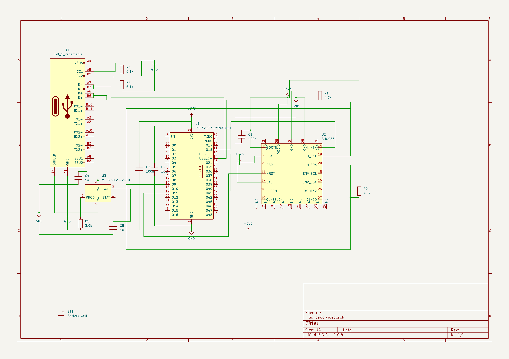
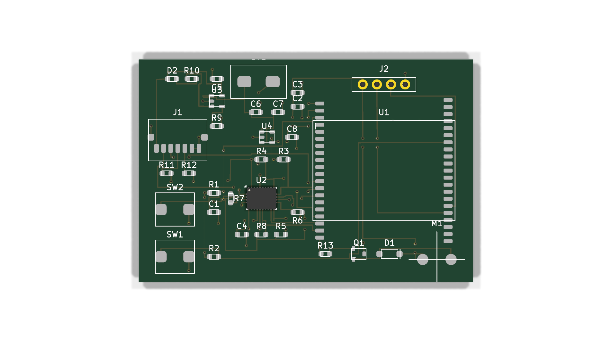
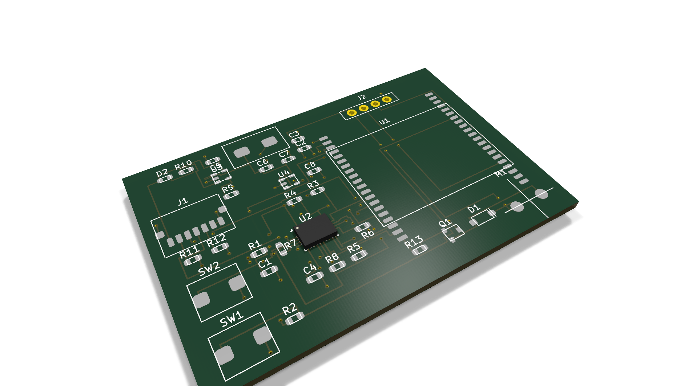
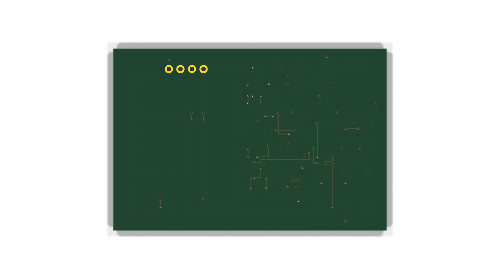

# Palma Advanced Cursor Control (PACC)

PACC is a glove based controller inspired by sci-fi movies that lets you control any device using your palm without ever touching a mouse. The idea is to have something similar to how you control things on an Apple Vision Pro, but for any regular computer or device.

## How it works

The glove uses an onboard IMU and flex sensors to track your hand orientation and finger movements, which an ESP32 translates into standard HID mouse commands sent over Bluetooth or USB-C.

### Hardware layout

- **IMU on the back of the hand / palm**: Tracks hand tilt and orientation in real time.
- **Flex sensors on fingers**: Detects bends, pinches, and finger taps.
- **ESP32 microcontroller**: Handles sensor data processing and sends mouse commands over Bluetooth HID or USB.
- **LiPo battery**: Powers the wearable from the wrist.

## Hardware & PCB Design

### Schematic
The complete custom circuit schematic features the ESP32-S3 microcontroller, BNO085 9-DOF IMU, TP4056 LiPo charging management, TLV75533P 3.3V LDO regulator, USB-C interface with CC pull-downs, tactile buttons for Boot and Reset, status LEDs, and an ERM haptic feedback motor driver with flyback diode protection.

*(Vector PDF available in [images/schematic.pdf](images/schematic.pdf))*

### PCB Design & 3D Renders
The custom PCB is designed as a compact 2-layer wearable board (60 mm × 40 mm) with a continuous ground plane, optimized high-frequency routing, and filtered power distribution. All 26 nets are fully routed with 0 DRC errors and 0 unconnected items.

| Top View (3D Render) | Isometric View (3D Render) |
| :---: | :---: |
|  |  |

| Bottom View (3D Render) | 2D Routing & Traces |
| :---: | :---: |
|  |  |

- **Fabrication Files**: Production-ready Gerbers and drill files are archived in [`gerbers.zip`](gerbers.zip) and [`fabrication/gerbers.zip`](fabrication/gerbers.zip).
- **Bill of Materials (BOM)**: Complete component list with part numbers, quantities, costs, and purchasing links is documented in [`BOM.md`](BOM.md) and [`BOM.csv`](BOM.csv).

## Firmware & Motion Control

The firmware located in [`firmware/pacc_firmware.ino`](firmware/pacc_firmware.ino) implements:
- Real-time sensor fusion using the onboard BNO085 (Game Rotation Vector / Angular Velocity at 50Hz).
- Adaptive deadzone filtering and non-linear cursor acceleration for sub-millimeter precision.
- Native Bluetooth Low Energy (BLE) HID mouse emulation via `BleMouse`.
- Haptic motor feedback confirmation on clicks.

## Planned gestures

The goal is to keep interactions natural and simple:

- **Tilt = Move**: Tilt your hand to move the cursor across the screen.
- **Pinch = Click**: Pinch your fingers together for a standard left click.
- **Tap = Right click**: Quick finger tap triggers a secondary right click.
- **Swipe = Scroll**: Swipe your hand to scroll through pages and documents.

## Multi-device control

One glove can stay paired with multiple devices at once (laptop, phone, tablet) so you can switch between screens seamlessly without having to disconnect and reconnect every time.

## Engineering challenges

Key things to solve during the build:

- **Battery life**: Keeping power consumption low while reading sensors and running Bluetooth.
- **Bluetooth delay**: Minimizing input latency so cursor movement feels snappy.
- **Sensor calibration**: Filtering noise and drift from the IMU.
- **Comfort**: Making the glove lightweight and easy to wear for long sessions.

## Future roadmap

This first prototype is built as a glove to test the sensors and tracking algorithms. Once everything works reliably, the long-term goal is to shrink the entire system down into a compact ring.

## Author

Designed and built by Harinandan J V for Hack Club's Half Life.
